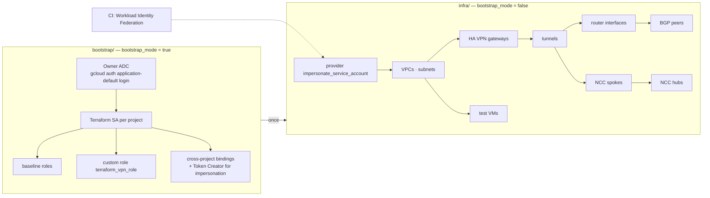
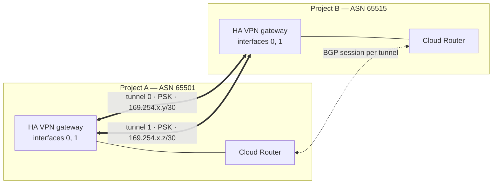
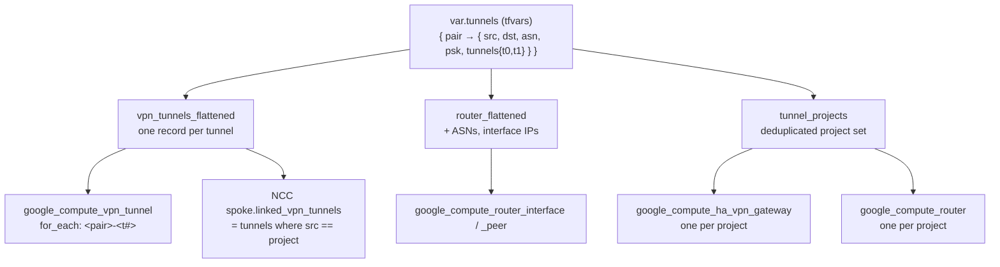

# Architecture

Diagrams for the hub-and-spoke HA VPN scaffold. Narrative: [`../README.md`](../README.md). Detailed network logic: [`SETUP-GUIDE.md`](SETUP-GUIDE.md) (sections "Hub and Spokes Network Configuration" and "Full dependency chain").

## Two phases, two roots

## One tunnel pair

Router interface `ip_range` = the full `/30`. Peer `peer_ip_address` = `split("/", cidr)[0]`.

## Data-driven expansion

Adding a project = one `spokes` entry + its `tunnels` entries. Nothing else changes.
